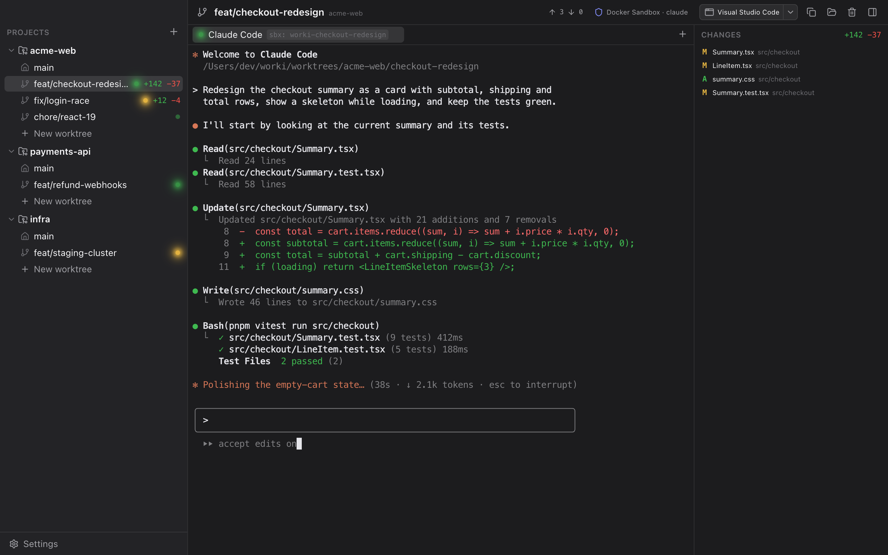

<p align="center">
  
</p>

<h1 align="center">worki</h1>

<p align="center">
  <b>Run coding agents in parallel, each in its own git worktree, each locked in its own sandbox.</b>
</p>

<p align="center">
  <a href="https://github.com/silvanfischer/worki/actions/workflows/ci.yml"></a>
  
  <a href="LICENSE"></a>
</p>

<p align="center">
  
</p>

Coding agents are at their best when you let them run on their own: accept edits, run the tests,
try again. That's exactly when you don't want them anywhere near your SSH keys, your browser
profile or your other repositories.

worki is a native macOS app that gives every task its own git worktree and its own isolated
environment, and shows all your agents side by side. Isolation isn't a plugin or a wrapper
script; it's how worki starts every agent.

## Isolation, built in

Pick where agents run: globally, per project or per worktree. worki sets the environment up,
checks it and cleans it up again.

| Isolation | What the agent gets | Needs |
|---|---|---|
| **User Isolation** | A hidden macOS user (`_worki`) that can only reach the worktrees it was given. Your home folder stays unreadable. | Nothing extra; a one-time admin setup |
| **Docker Sandboxes** | Its own Linux microVM per worktree | Docker Sandboxes (`sbx`) |
| **Docker** | Its own container per worktree, from a small Alpine image worki builds for you | Docker Desktop |
| **Podman** | The same, on Podman | A Podman machine |
| **None** | Runs as you, for trusted work | — |

<p align="center">
  
</p>

- **Only the worktree, nothing else.** The worktree is mounted (or, for User Isolation, granted
  by ACLs) at the same path as on your Mac, so paths in agent output match yours. Git hooks and
  config are read-only, so an agent can't plant a hook that later runs as you.
- **A doctor for every backend.** Checks phrased the way you'd want to read them ("_worki can't
  read files in your home folder") with one-click fixes: create the agent user, start the
  daemon, build the image.
- **Agents ready inside the sandbox.** Install Claude Code or Codex into the environment, or
  reuse your own installation. Copy your agent configuration (settings, `CLAUDE.md`, agents,
  commands, skills) and sign in with a token that uses your subscription, while your own login
  stays untouched. Setup is remembered and repeated for every new environment.
- **Secrets stay in your Keychain.** Tokens are stored per isolation and passed to sessions as
  environment variables.
- **No leftovers.** Environments start with the first session, stop when worki quits and are
  removed together with their worktree or project.

<p align="center">
  
</p>

## Everything around it

- **Parallel worktrees.** Branch off any existing branch in one step, with an optional setup
  script (`pnpm install`, copying `.env` files) that runs in the same isolation as the agent.
- **See who needs you.** A status dot per agent shows whether it's working, waiting for you or
  idle. You get a notification and a Dock badge when one is waiting.
- **Real terminals.** Agent and shell sessions in GPU-rendered terminals that keep running when
  you switch worktrees.
- **Review in place.** Changed files and diffs for every worktree, next to the agent.
- **Remote projects.** Work on repositories on an SSH host; sessions run in tmux there and
  survive a dropped connection.
- **Open in anything.** Jump to the worktree in your editor or terminal from the toolbar.

## Getting started

worki builds from source. You need macOS, Rust (stable), Node 20+, pnpm and the Xcode command
line tools. For container isolation, install Docker Sandboxes, Docker Desktop or Podman.

```bash
git clone https://github.com/silvanfischer/worki.git
cd worki
pnpm install
pnpm tauri dev
```

Add a repository with **+**, create a worktree, pick its isolation, and start an agent. The
doctor walks you through anything that's missing.

### Share setup with your team

Commit a `.worki.toml` to give every worktree the same base branch and setup script:

```toml
[worktree]
base = "main"
setup = """
cp "$WORKI_ROOT_PATH/.env.local" .env.local
pnpm install
"""
```

A setup script set in the project settings overrides the file.

## Development

```bash
cargo test --workspace
pnpm typecheck
```

End-to-end tests against real container engines (need `sbx`, Docker Desktop or a Podman machine):

```bash
cargo test -p worki-isolation --test containers -- --ignored
```

| Path | What |
|---|---|
| `crates/worki-isolation` | Isolation backends: macOS user, Docker Sandboxes, Docker, Podman, SSH |
| `crates/worki-core` | Projects, worktrees and git (local and over SSH), SQLite store, agent settings |
| `crates/worki-pty` | PTY sessions with replay buffer and agent activity tracking |
| `src-tauri` | Tauri app and IPC commands |
| `ui` | React + Tailwind frontend |

Design notes are in [docs/design.md](docs/design.md).

## License

[MIT](LICENSE)
