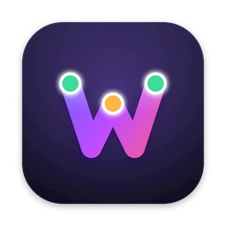
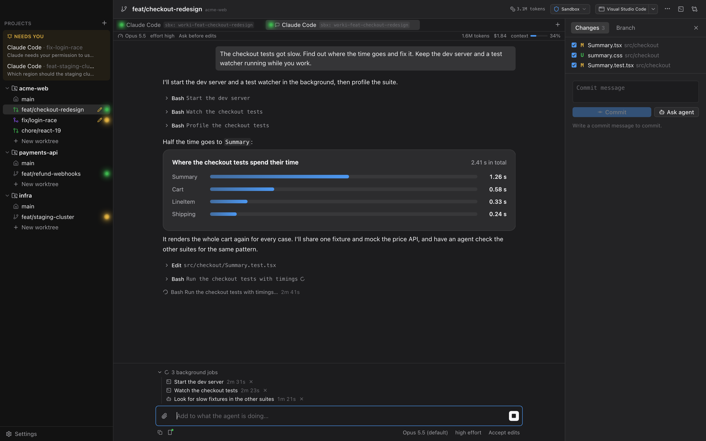
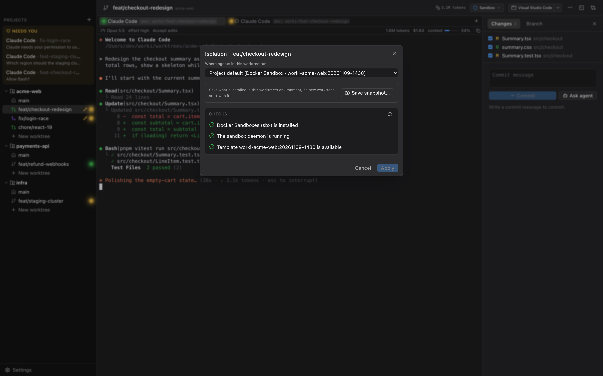
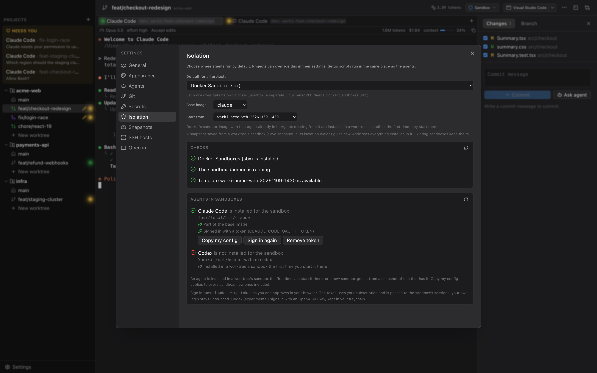
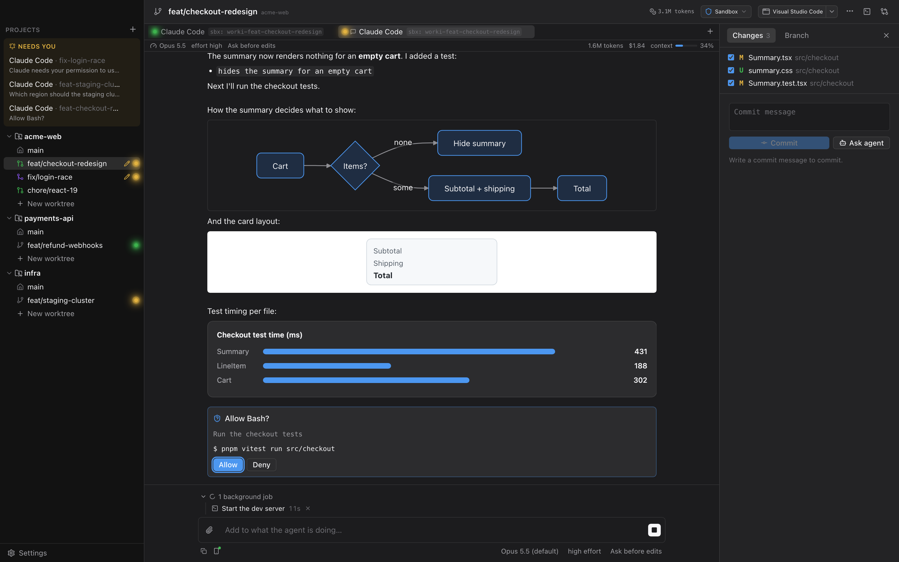
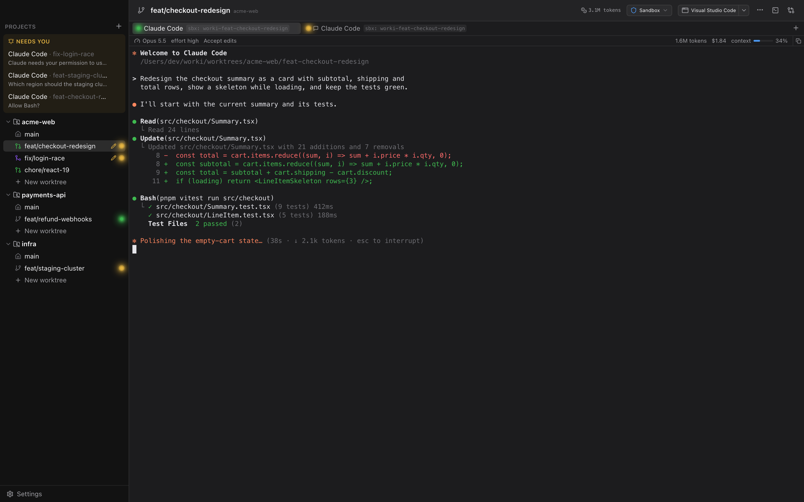
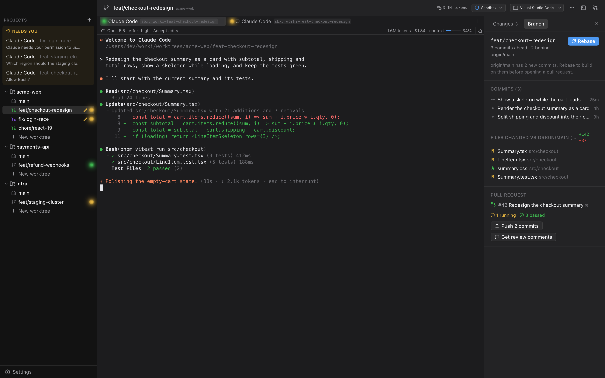

<p align="center">
  
</p>

<h1 align="center">worki</h1>

<p align="center">
  <b>Run coding agents in parallel, each in its own git worktree, each locked in its own sandbox.</b>
</p>

<p align="center">
  <a href="https://github.com/silvanfischer/worki/releases/latest"></a>
  <a href="https://github.com/silvanfischer/worki/actions/workflows/ci.yml"></a>
  
  <a href="LICENSE"></a>
</p>

<p align="center">
  
</p>

Coding agents are at their best when you let them run on their own: accept edits, run the tests,
try again. That's exactly when you don't want them anywhere near your SSH keys, your browser
profile or your other repositories.

worki is a native macOS app that gives every task its own git worktree and its own isolated
environment, and shows all your agents side by side. Isolation isn't a plugin or a wrapper
script; it's how worki starts every agent.

## Isolation, built in

Pick where agents run: globally, per project or per worktree. worki sets the environment up,
checks it and cleans it up again.

| Isolation | What the agent gets | Needs |
|---|---|---|
| **User Isolation** | A hidden macOS user (`_worki`) that can only reach the worktrees it was given. Your home folder stays unreadable. | Nothing extra; a one-time admin setup |
| **Docker Sandboxes** | Its own Linux microVM per worktree | Docker Sandboxes (`sbx`) |
| **Docker** | Its own container per worktree, from a small Alpine image worki builds for you | Docker Desktop |
| **Podman** | The same, on Podman | A Podman machine |
| **None** | Runs as you, for trusted work | — |

<p align="center">
  
</p>

- **Only the worktree, nothing else.** The worktree is mounted (or, for User Isolation, granted
  by ACLs) at the same path as on your Mac, so paths in agent output match yours. Of the
  repository's `.git`, only what committing needs is writable; hooks and config stay read-only,
  so an agent can't plant anything that later runs as you.
- **No credentials unless you hand them over.** No SSH agent, no `~/.gitconfig` or git
  credential helper, no GitHub CLI login and none of your environment variables (API keys in your
  shell) reach an agent; it gets the terminal type, language and worki's own session variables,
  plus the tokens you store for an isolation. With isolation set to None, an agent runs as you.
- **A doctor for every backend.** Checks phrased the way you'd want to read them ("_worki can't
  read files in your home folder") with one-click fixes: create the agent user, start the
  sandbox daemon or Podman machine, build the image.
- **Agents ready inside the sandbox.** Claude Code, or Codex (experimental), is installed in a
  worktree's environment the first time you start it there, and the agent trusts the worktree
  without asking. Copy your agent configuration (settings, `CLAUDE.md`, agents, commands, skills)
  into every environment, and sign in with a token that uses your subscription, while your own
  login stays untouched. Codex signs in with an API key, or per environment with a code you
  approve in the browser.
- **Secrets stay in your Keychain.** Tokens are stored per isolation and passed to sessions as
  environment variables.
- **Snapshots.** Install what a project needs (a JDK, system packages) once, save the worktree's
  sandbox or container as a snapshot, and the project's new worktrees start from it with
  everything installed.
- **Agents stay put.** Environments keep running when worki quits (or stop, if you prefer), and
  Claude Code sessions pick up their conversation when worki starts again.
- **No leftovers.** Environments are removed together with their worktree or project.

<p align="center">
  
</p>

## Chat or terminal

<p align="center">
  
</p>

Run Claude Code in its terminal, or as a chat that worki draws itself:

- **The conversation, readable.** Answers stream in as Markdown, tool calls fold into one line
  each and open to show the command, the diff or the output.
- **Questions as buttons.** Permission requests get Allow and Deny, the agent's questions their
  options, and Esc stops a turn.
- **Switch while you talk.** Model, effort and permission mode sit under the message box.
- **Attach text files and images, or paste screenshots.** worki reads them itself, so they reach agents in any
  isolation.
- **Visuals in place.** Diagrams (Mermaid), drawings (SVG) and charts (HTML, in a sandboxed frame)
  match worki's theme and open full-window. Diagrams and drawings zoom and save as SVG or PNG;
  charts save as HTML.
- **Picks up where you left off.** Chats reopen with their history when worki starts.
- **Continue on your phone.** Turn on Remote Control below the message box and carry on in the
  Claude app or on claude.ai/code; what you send from there shows up in worki. Under Settings ›
  Agents, new Claude Code sessions, terminals included, start with it. In Docker Sandboxes it
  needs `sbx settings set claude.remoteControl true` once.

<p align="center">
  
</p>

Choose the default under Settings › General; the **+** menu offers both.

**Codex (experimental).** Codex runs as a chat or in a terminal, in any isolation. worki installs it with OpenAI's
installer, signs it in with an OpenAI API key from your Keychain, lists it under
**Needs you** when it asks for approval or finishes a turn, and resumes its conversation when
worki starts again. The status bar details (model, context, token usage) are Claude Code only.

## From task to pull request

<p align="center">
  
</p>

- **Commit** the files you pick from the **Changes** tab, or let the agent write the commit
  messages.
- **Branch** tab: how the branch stands against the branch it was started from, with **Rebase** (it fetches
  first; on conflicts nothing changes and the agent can resolve them), the branch's commits and
  every file it touched.
- **Pull requests** through the GitHub CLI: create one, follow its checks, push new commits, and
  pull review comments into worki to send them to the agent. The sidebar shows each worktree's
  pull request (open, draft, merged or closed) and marks failed checks.
- **Review in place.** Comment on any diff line, expand hidden context, and send the comments to
  the agent as one review.

Commits and pull requests can be turned off under Settings › Git. Pull requests need
[`gh`](https://cli.github.com) installed and signed in (`gh auth login`).

## Everything around it

- **Parallel worktrees.** Branch off any existing branch in one step, with an optional setup
  script (`pnpm install`, copying `.env` files) that runs in the same isolation as the agent.
- **See who needs you.** Agents waiting for an answer are listed under **Needs you**, across all
  projects, the moment they ask, with a notification and a Dock badge.
- **Real terminals.** Agent and shell sessions in GPU-rendered terminals that keep running when
  you switch worktrees, a shell of your own below the agent (⌃\`), and links that open in your
  browser, sign-in links included. For Claude Code, the status bar shows model, context and token
  usage. YOLO mode is one checkbox per agent.
- **Remote projects.** Work on repositories on an SSH host, with saved hosts you set up once;
  terminal sessions run in tmux there and survive a dropped connection.
- **Keyboard first.** ⌘K jumps to any worktree or action, ⌘T starts an agent, ⌘J shows the
  changes.
- **Open in anything.** Jump to the worktree in your editor or terminal from the toolbar.

## Getting started

1. Download `worki_<version>_universal.dmg` from the
   [latest release](https://github.com/silvanfischer/worki/releases/latest). It runs on
   Apple Silicon and Intel Macs with macOS 13 or later, and is signed and notarized by Apple.
2. Open the DMG and drag **worki** into **Applications**.
3. For container isolation, install Docker Sandboxes, Docker Desktop or Podman. User Isolation
   needs nothing extra.

Add a repository with **+**, create a worktree, pick its isolation, and start an agent. The
doctor walks you through anything that's missing.

### Build from source

You need Rust (stable), Node 20+, pnpm and the Xcode command line tools.

```bash
git clone https://github.com/silvanfischer/worki.git
cd worki
./start_dev.sh
```

`start_dev.sh` installs the frontend dependencies when needed, compiles the app and starts it with
hot reload for the UI.

Dev builds keep their secrets in `~/Library/Application Support/worki/dev-secrets.json`, readable
only by you, instead of the Keychain: macOS would ask again for Keychain access after every rebuild.

### Share setup with your team

Commit a `.worki.toml` to share the setup script, and the base branch worki picks up when the
project is added:

```toml
[worktree]
base = "main"
setup = """
cp "$WORKI_ROOT_PATH/.env.local" .env.local
pnpm install
"""
```

A setup script set in the project settings overrides the file.

## Development

```bash
cargo test --workspace
pnpm typecheck
```

The README screenshots are the real UI rendered against demo data (`ui/demo.html`):

```bash
scripts/screenshots.sh
```

End-to-end tests against real container engines (need `sbx`, Docker Desktop or a Podman machine):

```bash
cargo test -p worki-isolation --test containers -- --ignored
```

| Path | What |
|---|---|
| `crates/worki-isolation` | Isolation backends: macOS user, Docker Sandboxes, Docker, Podman, SSH |
| `crates/worki-core` | Projects, worktrees and git (local and over SSH), SQLite store, agent settings |
| `crates/worki-pty` | PTY sessions with replay buffer and agent activity tracking |
| `src-tauri` | Tauri app and IPC commands |
| `ui` | React + Tailwind frontend |

Design notes are in [docs/design.md](docs/design.md).

## License

[MIT](LICENSE)
